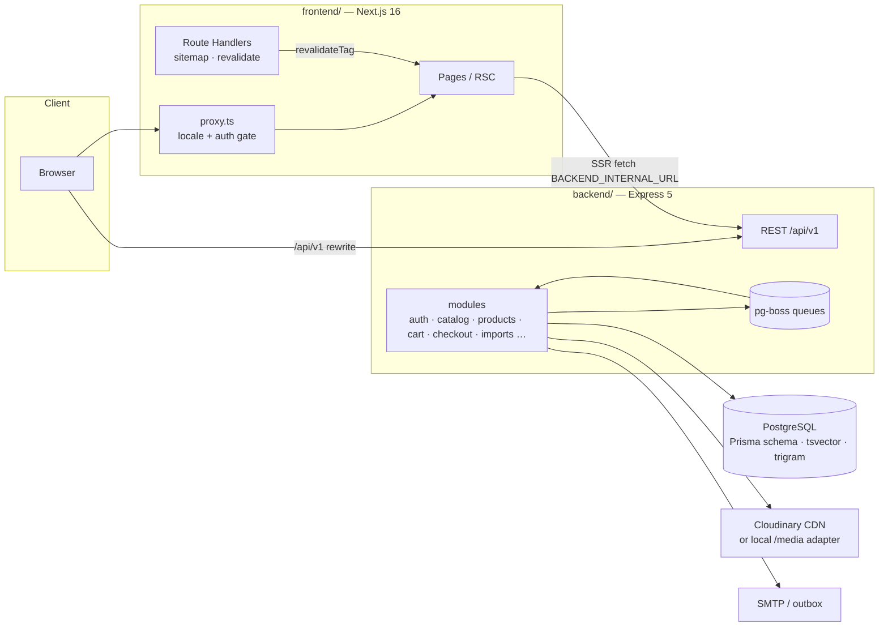

# ToolHub India — B2B Industrial Tools eShop

Production-grade B2B industrial tooling eShop (Hoffmann-style): deep category tree, product
families with many variants, customer-specific B2B pricing, faceted filtering, quick-order
tools, guest carts, a full admin panel and a strict Excel/CSV bulk-import pipeline.

Two standalone projects (no monorepo tooling — see `docs/adr/0001-two-standalone-projects.md`):

| Project | Stack | Runs on |
|---|---|---|
| `frontend/` | Next.js 16 (App Router) · React 19 · TypeScript strict · Tailwind CSS 4 · Radix UI · TanStack Query · Zustand · react-hook-form + zod | http://localhost:3000 |
| `backend/` | Node 22 · Express 5 · TypeScript strict (ESM) · Prisma 6 + PostgreSQL · pg-boss · pino · zod-to-openapi | http://localhost:4000 |

They talk over HTTP only. The frontend reaches the API via `NEXT_PUBLIC_API_URL`
(same-origin `/api/v1` rewrite in dev → `BACKEND_INTERNAL_URL`).

## Running locally

Prereqs: Node 22+, npm, and any PostgreSQL 14+ reachable via a URL (local install, Supabase, …).
This workspace also ships a user-space PostgreSQL 18 for dev/test (no Docker needed):

```bash
# 0) (workspace helper, optional) start the bundled dev database on 127.0.0.1:5433
bash scripts/pg-start.sh

# 1) backend
cd backend
cp .env.example .env            # then set DATABASE_URL/DIRECT_URL + secrets
npm install
npm run db:migrate              # prisma migrate deploy + generate
npm run db:seed                 # categories, ~200 products, admin user, banners, CMS
npm run dev                     # http://localhost:4000  (docs: /api/docs)

# 2) frontend (new terminal)
cd frontend
cp .env.local.example .env.local
npm install
npm run dev                     # http://localhost:3000 → redirects to /in/en
```

One-command alternative (starts Postgres + backend + frontend, daemonized so
the servers keep running after the script exits; skips anything already up):

```bash
bash scripts/start-app.sh        # storefront :3000 · API :4000 · Postgres :5433
```

Default admin sign-in (seed): `admin@example.com` / value of `SEED_ADMIN_PASSWORD` (`Admin123!secure` in dev).
Dev mail lands in `backend/var/outbox/` (preview: `cd backend && npm run mail:preview`).

## Scripts

| Where | Command | What it does |
|---|---|---|
| backend | `npm run dev` / `build` / `start` | tsx watch / tsc + node |
| backend | `npm run db:migrate` / `db:seed` / `db:reset` | deploy migrations / seed / reset |
| backend | `npm test` / `test:coverage` | vitest (unit + API integration) |
| backend | `npm run lint` / `typecheck` / `lint:circ` | eslint / tsc / madge circular check |
| backend | `npm run openapi:export` | writes `docs/openapi.json` |
| frontend | `npm run dev` / `build` / `start` | Next dev / production build |
| frontend | `npm run lint` / `typecheck` / `test` | eslint / tsc / vitest |
| root | `node scripts/sync-shared.mjs` | mirror `backend/src/shared` → `frontend/src/shared` |
| root | `bash scripts/start-app.sh` | start the whole stack (Postgres + backend + frontend), daemonized |
| root | `bash scripts/with-backend-build.sh` | `next build` with the backend up (SSG needs it) |

## Environment variables

Backend (`backend/.env.example`) — all documented inline: `DATABASE_URL`, `DIRECT_URL`,
`JWT_ACCESS_SECRET`/`JWT_REFRESH_SECRET`/`HMAC_SECRET` (32+ chars each), `CORS_ORIGINS`,
`MAIL_PROVIDER=file|smtp`, `QUEUE_ENABLED`, `STORAGE_ADAPTER=local|cloudinary` (+ Cloudinary keys),
`PAYMENT_PROVIDER=invoice|razorpay|mock`, `REVALIDATE_SECRET`.

Frontend (`frontend/.env.local.example`): `NEXT_PUBLIC_SITE_URL`, `NEXT_PUBLIC_API_URL`,
`BACKEND_INTERNAL_URL`, `NEXT_PUBLIC_CLOUDINARY_CLOUD_NAME`, `REVALIDATE_SECRET`.

No secrets are committed; both `.gitignore`s exclude env files.

## Folder map

```
frontend/src
├─ app/            # routes only (shop/auth/account/admin route groups, sitemaps, robots)
├─ features/       # feature modules (UI + hooks + API calls)
├─ components/     # ui/ primitives · layout/ · seo/
├─ lib/            # api-client, image loader, formatters, hooks
├─ config/         # brand.ts · site.ts · routes.ts · env.ts
├─ shared/         # mirrored zod schemas/DTOs (from backend/src/shared)
└─ styles/         # tokens.css (design tokens) · globals.css

backend/src
├─ server.ts→main.ts→app.ts   # entry → bootstrap → express assembly
├─ config/         # env (zod, fail-fast) · logger · constants (error codes)
├─ common/         # errors · middleware · response envelope · pagination · utils
├─ db/             # prisma singleton · withTransaction
├─ services/       # mail · queue (pg-boss) · cache · settings
├─ shared/         # zod schemas + DTO types + enums (source of truth, mirrored)
├─ modules/        # one folder per domain: routes/controller/service/repository/schemas
└─ jobs/           # background workers (imports, emails, counts, revalidation)

docs/              # architecture · database · api · import · seo · deployment · adr/
```

## Architecture overview



More docs: `docs/architecture.md`, `docs/database.md`, `docs/api.md`, `docs/import.md`,
`docs/seo.md`, `docs/deployment.md`, `docs/contributing.md`, and every ADR in `docs/adr/`.
