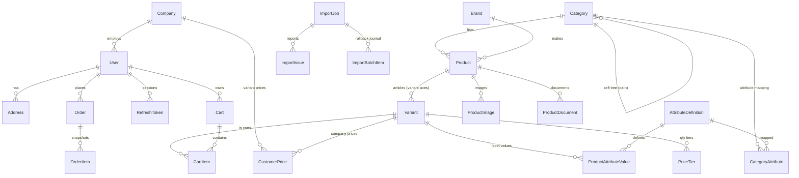

# Database

PostgreSQL 14+ (developed against 18). Prisma is the only writer. Schema source:
`backend/prisma/schema.prisma` (spec Section 8 verbatim + documented additions, see
`docs/adr/0003-schema-additions.md`).

## ERD (core commerce flow)

## Model purposes

| Model | Purpose |
|---|---|
| `User` / `Company` | B2B/B2C accounts; RBAC via `role` (CUSTOMER/STAFF/ADMIN) |
| `OtpCode` | email OTP (register/login/reset) hashed with HMAC-SHA256, attempts+TTL |
| `RefreshToken` | rotating refresh tokens, hashed, with `familyId` for reuse detection |
| `Address` | shipping/billing addresses |
| `Category` | tree via `parentId` + materialized `path`/`pathSlugs`; `code` is the stable lookup key; `productCount` is a job-maintained subtree aggregate |
| `Brand`, `AttributeDefinition`, `CategoryAttribute` | catalog vocabulary; per-category filter/variant-axis mapping |
| `Product` | family; `searchVector` tsvector (trigger-maintained, see ADR 0002); `minPrice` denormalised price-from |
| `Variant` | sellable article (articleNo unique, EAN, price, stock, lead time, MOQ/pack) |
| `ProductAttributeValue` | normalized per-variant attribute values (string/number/bool) powering facets |
| `PriceTier`, `CustomerPrice` | quantity tiers; company-specific prices with validity dates |
| `ProductImage`, `ProductDocument` | media (Cloudinary publicIds or local adapter) and downloads |
| `Cart` / `CartItem` | guest carts (`anonymousToken` cookie, hashed) and user carts |
| `Order` / `OrderItem` | immutable snapshots (prices, names, attributes JSON) |
| `Banner`, `CmsPage` | CMS content (placements; block-based pages) |
| `ImportJob`, `ImportIssue`, `ImportBatchItem` | bulk import state machine, issue log, rollback journal |
| `AuditLog`, `SearchQueryLog`, `AuthEvent` | audit trail, search analytics, brute-force lockout |
| `SlugRedirect`, `Setting`, `OrderSequence`, `NewsletterSubscriber`, `ContactMessage` | additions (ADRs 0003) |

## Index rationale

- Spec-declared: `Category(parentId,sortOrder)`, `Category(path)`, `Category(slug)`,
  `Product(categoryId,status)`, `Product(brandId)`, `Product(status,isBestseller)`,
  `Variant(productId,sortOrder)`, `Variant(listPrice)`, `ProductAttributeValue(attributeId,valueString/valueNumber)`,
  `Order(userId,createdAt)`, unique constraints on articleNo/ean/customerNumber/orderNo.
- Raw-SQL additions (`20261121040001_search_and_perf`): GIN on `Product.searchVector`;
  trigram GIN on `Variant.articleNo` and `Product.name` (typo tolerance); partial indexes for
  the published/active listing path; FK indexes (`Address.userId`, `CartItem.variantId`,
  `OrderItem.orderId`, `Variant.ean`); `Order(status, createdAt)` for admin lists.
- pg-boss keeps its own `pgboss` schema (created at runtime) — not part of Prisma migrations.

## Maintained aggregates

- `Category.productCount` — subtree counts, recomputed by a queued job after catalog writes/imports.
- `Product.minPrice` — refreshed on variant price changes (listing "price from").
- `Product.searchVector` — triggers (ADR 0002).
